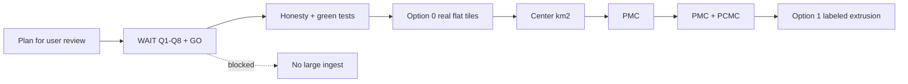
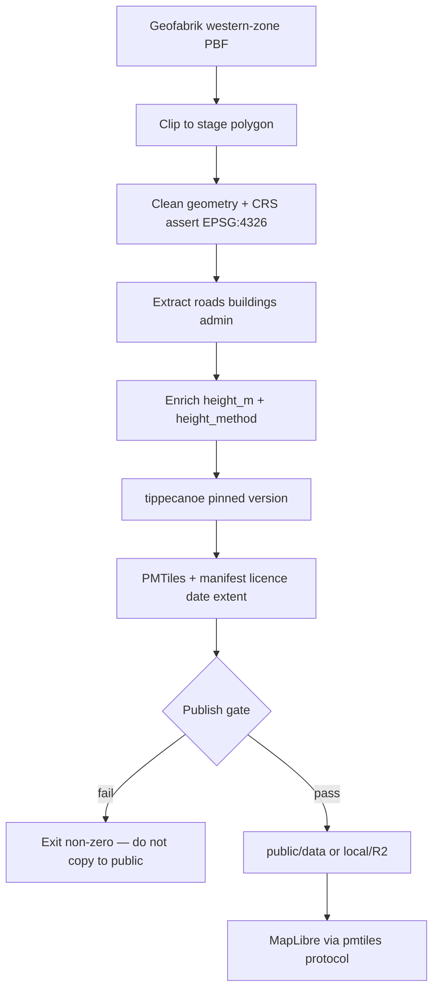

# Puneverse — Real open geo + 3D plan

**Date:** 2026-11-11  
**Status:** CONDITIONAL GO for **user plan review only**  
**Ingest:** HOLD — do not download Geofabrik / bake tiles until user GO  
**Product SHIP:** HOLD  

**G0 locks (do not reopen):** Scope B = PMC + PCMC; cantonments In; EN labels; wards + gazetteer; free only. Kill: silent heights; Overpass as production; full-PMR building LOD in Phase 1.

**Analogy:** Today the map is a labeled cardboard city. This plan swaps it for a real street survey (Option 0), then adds building “pop-ups” only where height provenance is labeled (Option 1). No fake skyline.

---

## Verdict banner

| Gate | Verdict |
|------|---------|
| Plan for user review | CONDITIONAL GO (this document) |
| Large-scale data ingest | HOLD |
| Product SHIP | HOLD |
| Recommended build order | Option 0 (reuse) → staged extents → Option 1 (extrusion) |
| Rejected | Cesium / heavy Three city; Overpass production; silent heights; full-PMR buildings in Phase 1 |

---

## 1. Repo findings (fake vs real today)

Live re-xray of the local PuneVerse checkout (2026-11-11).

| Layer | Path | On disk | What it is |
|-------|------|---------|------------|
| Admin | `public/data/overlays/admin.sample.geojson` | Yes | Fake orange twin-city box (~2 polygons). Not wards. |
| Roads | `public/data/overlays/roads.sample.geojson` | **MISSING** | Config/tests expect it. Stale spokes survive only under `dist/` (gitignored). Radial / cross lines through city center — not OSM. |
| Buildings | `public/data/overlays/buildings.sample.geojson` | Yes (~54 polys) | Fake downtown footprints. Flat `fill` in MapLibre. File carries fabricated `height_m` / `height_method` / `building:levels` that paint **ignores**. |
| Places | `public/data/places.index.json` | Yes | Fixture names (`fixture: true`). |
| Water / Parks | — | No geometry | UI stub only. |

**How overlays attach**

- Config: `config/cities/pune.json` (JSON, not YAML) — `layers.*.status: sample|stub`
- Store: Zustand `mapStore` toggles
- Map: `MapView` → `ensureSampleOverlays` in `src/map/overlays.ts` (GeoJSON `fill` / `line` only)
- Basemap 3D: `hideBasemapFillExtrusions` turns off style `fill-extrusion` layers on purpose

**Height / extrusion**

- App SAMPLE buildings: **not extruded**
- Basemap 3D: **hidden**
- Honesty / docs claim flat / no fabricated heights — **contradicts** live buildings SAMPLE props → honesty drift

**Pipeline**

- `pipeline/check_raw_data.py`: stub (raw PBF presence only)
- `src/map/pmtiles.ts`: no-op
- tippecanoe / PMTiles: deferred (prior brew untrusted-tap failure)
- MapLibre worker fix: **landed** (`maplibreWorker.ts` + Vite worker ES)

**What to delete / replace**

| Remove as “real” | Replace with |
|------------------|--------------|
| `*.sample.geojson` as default | Clipped OSM → tippecanoe → PMTiles (or honest interim GeoJSON from real extract) |
| Fabricated SAMPLE heights | Provenanced `height_m` + `height_method` only in Option 1; strip or retire SAMPLE props in P0 |
| Fixture places + orange admin | Open ward / admin polygons + gazetteer |
| Placeholder `maxBounds` as boundary | PMC ∪ PCMC (+ cantonments policy) polygons |

**Tests:** `npm test` currently red (missing roads; buildings count / height-key rules). Fix before any `ready` status.

### Field carrier inventory (building heights)

| Field | Today in repo | Trust | Option 1 use |
|-------|---------------|-------|--------------|
| `height_m` | Fabricated on SAMPLE | Poison until real enrich | Normalized metres |
| `height_method` | Fabricated labels | Poison until real enrich | Provenance enum |
| `building:levels` | Fabricated on SAMPLE | Poison | → `levels_x_3m` when from OSM |
| OSM `height` / `min_height` / `roof:height` | Not ingested | — | `explicit` |
| Google 2.5D | Not ingested | — | `google_25d` if licensed |
| `CityConfig.honesty.heights` | Copy says no fabricated heights | Stale vs data | Rewrite with cutover |
| `layers.*.status` | `sample` / `stub` / `ready` | Good reuse | Flip to `ready` only after gate |

### Consumer audit

| Consumer | Status | Notes |
|----------|--------|-------|
| MapLibre SAMPLE fill/line | ✅ | Works for flat overlays |
| MapLibre fill-extrusion (own) | ❌ | Not wired |
| Basemap fill-extrusion | ✅ handled | Hidden on purpose — keep until own honest layer |
| Attribution / About / honesty UI | ⚠️ | Exists; copy stale vs buildings file |
| CI (lint/typecheck/test/build) | ⚠️ | Tests red on fixtures |
| Pipeline / tippecanoe / PMTiles | ❌ | Stub / deferred |
| Vite MapLibre worker | ✅ | Fixed |
| Query DB / Kafka / haystack | ❌ N/A | Static SPA |

---

## 2. Boundary strategy

| Boundary | Role | Source posture |
|----------|------|----------------|
| PMC polygon | Clip + admin | Free civic / OSM admin — document date + provenance |
| PCMC polygon | Clip + admin | Same |
| **PMC ∪ PCMC** | Product mask (Scope B) | Boolean union; drive `maxBounds` from padded union |
| Cantonments (In) | Inside extent | No free official SHP found → OSM indicative **or** disclose gap — never fake official |
| PMR / PMRDA | Outline only | data.gov.in / PMRDA GIS — **not** Phase 1 building LOD |
| Wards + gazetteer | Places / labels | Data-driven; **no** hardcoded neighbourhood cool-list |

**Ward SoT conflict:** Bharatlas “58 wards” vs OpenCity “15 administrative wards 2025” — different products. Pick one primary (Q4). Do not mix labels.

---

## 3. Data source catalogue (licence + coverage)

| Source | Role | Licence | Coverage evidence | Scope B fit |
|--------|------|---------|-------------------|-------------|
| Geofabrik western-zone OSM | Roads, buildings, water/parks tags, admin relations | **ODbL 1.0** | https://download.geofabrik.de/asia/india/western-zone.html (~211 MB PBF) | Primary — must clip |
| Google Open Buildings v3 polygons | Footprints | Dual **CC-BY-4.0 or ODbL** | https://sites.research.google/open-buildings/ | Optional; clip AOI |
| Google Open Buildings 2.5D temporal | Height rasters 0–100 m | Dual **CC-BY-4.0 and ODbL** (pick one) | EE catalog temporal v1 | Optional for Option 1 |
| OpenCity / Bharatlas PMC wards | Ward polygons | **Conflict** (CKAN PD vs FAQ ODbL vs Bharatlas ODbL) | https://data.opencity.in/dataset/pune-wards-info | High after clearance |
| DataMeet / Bharatlas PCMC wards | Ward polygons | **Conflict** (historic CC BY-SA vs Bharatlas CC-BY-4.0) | https://bharatlas.com/view/wards_pcmc | High after clearance |
| Survey of India admin | District/taluk | Free download (not OSI SPDX on FAQ) | onlinemaps.surveyofindia.gov.in | Low for wards |
| PMRDA / data.gov.in | Metro outline | GODL likely — confirm resource page | https://gis.pmrda.gov.in/ | Outline only |
| Esri India wards Online | PMC 2022 | Offline export **forbidden** | arcgis.com item | **Reject** |
| Microsoft Global ML Buildings | Footprints | CDLA Permissive 2.0 (confirm download) | GitHub GlobalMLBuildingFootprints | Q5 in/out |
| Overpass API | Discovery counts only | — | Archival evidence | **Not production** |

**OSM height sparsity (planning evidence only, Overpass bbox ~urban box, 2026-11-11):** ~288k buildings; ~1.28% with `building:levels`; ~0.25% with `height`. City-scale 3D needs labeled estimates and/or Google 2.5D — never silent fill.

---

## 4. Height provenance model

Pipeline writes normalized props. Never write `height_m` without `height_method`.

| `height_method` | Rule | Extrude? |
|-----------------|------|----------|
| `explicit` | OSM `height` (+ `min_height` / `roof:height` when present) | Yes |
| `levels_x_3m` | `building:levels × 3` | Yes — labeled estimate |
| `google_25d` | Google 2.5D join **only if** Q2 approves license path | Yes — labeled |
| `default_estimate` | Fixed metres | Only if Q6 allows; **always** UI-labeled — prefer **off** in Phase 1 |
| `unknown` | No usable signal | **No extrusion** |

UI / About / legend must distinguish measured vs levels-derived vs Google vs default vs unknown (flat).

---

## 5. Pipeline architecture (fail-closed)

**Steps**

1. Pin source URL + checksum → `data/raw/` (gitignored)  
2. Clip to active stage (S0 → S1 → S2)  
3. Clean invalid polygons; assert CRS  
4. Enrich heights per Section 4 (Option 0 may omit height props entirely)  
5. tippecanoe → PMTiles (boundaries lower zooms; buildings high zoom)  
6. Fail-closed gate: license present, CRS OK, no `sample:true`, no radial-spoke heuristic fail, manifest written  
7. Publish to `public/` (small) or local serve / R2 (large; Q7)

**No Overpass in production refresh.**  
**Do not ship full PBF in the app / git.**

City-agnostic: `config/cities/{id}.json` + boundary files; same pipeline for a future city.

---

## 6. Radial geometry RCA + removal

**RCA:** SAMPLE roads were hand-authored LineStrings through `city.center` (E–W, N–S, diagonals, rings) — a spoke/cross motif, not a street network. No generator remains in `src/` or `pipeline/`. Source file was removed from `public/` while `dist/` still holds a stale copy → 404 in `npm run dev` and red tests. User-visible “cross lines” = this SAMPLE, not OSM.

**Removal plan**

1. P0: restore roads SAMPLE **or** drop roads from SAMPLE config/tests until real tiles (prefer drop-from-default once Option 0 center bake exists).  
2. Never treat `dist/` overlays as source of truth.  
3. Pipeline gate: fail if published roads look radial (high share of segments through clip centroid).  
4. Publish only clipped OSM highway ways.

---

## 7. 3D camera / navigation design

| Concern | Design |
|---------|--------|
| Engine | MapLibre only (pitch / bearing / maxPitch). No Cesium. |
| Option 0 default | Pitch 0 (flat) |
| Option 1 | Gentle pitch when extrusion on and zoom high (exact default = Q8) |
| Controls | Keep `NavigationControl({ visualizePitch: true })`; set `maxPitch` (~60–85) |
| Fly-to | Reuse store pitch/bearing |
| Reduced motion | `prefers-reduced-motion: reduce` → pitch 0; no auto tilt |
| Basemap 3D | Stay hidden until own labeled extrusion ships |

---

## 8. Phased extents (perf)

| Stage | Clip | Goal | Promote when |
|-------|------|------|--------------|
| S0 | Center ~2–5 km² | Pipeline + MapLibre smoke | FPS OK; CRS tests green; tile size measured |
| S1 | PMC polygon | Ward/admin + building density | Same + honesty UI matches |
| S2 | PMC ∪ PCMC (+ cantonments policy) | Scope B product | Same; free-tier headroom OK |

Full PMR = outline context later — not building LOD in Phase 1.

---

## 9. Test strategy

### Python (pipeline)

- CRS = EPSG:4326 (or documented transform then assert)  
- Clip non-empty; bbox inside stage mask  
- No empty “success” publish  
- Spoke / radial heuristic fail on roads  
- If Option 1: every extruded feature has `height_method`; forbid unlabeled `height_m`

### Frontend (Vitest / CI)

- Fixture GeoJSON / tiny PMTiles only (not full western-zone every PR)  
- LayerStatus / honesty keys present  
- Attribution strings present  
- After cutover: default layers do not load `*.sample.geojson`  
- `npm test` green before `ready`

### Manual smoke

- Zoom to extrusion min-zoom: 3D visible only for labeled methods  
- Mobile + reduced-motion stay flat  
- Tile 404 → empty + toast; shell usable  

Lakshman re-pass after first real bake (post user GO).

---

## 10. Risk / licensing

| Risk | Severity | Mitigation |
|------|----------|------------|
| SAMPLE honesty drift | High | P0 strip/align props + docs + tests |
| OSM + Google merge share-alike | High | Q2 pick CC-BY vs ODbL; prefer OSM-only extrusion first |
| Ward license conflict | High | Q4 + written clearance before redistribute |
| Cantonment official gap | Medium | Disclose OSM indicative vs omit + gap note |
| tippecanoe install blocked | High | Q3 binary / Felt pin / Docker / GeoJSON interim |
| Tile size > Pages 25 MiB / R2 free | Medium | Measure at S0; Q7 before R2; drop maxzoom |
| Sparse heights look “broken” | Medium | Badge + legend; unknown = flat |
| Scope creep to PMR buildings | High | Kill rule; outline only |
| Ingest without user GO | Critical | This plan’s hard gate |

---

## 11. Cost (free path)

| Item | Estimate | Gate |
|------|----------|------|
| Plan write + review | ~1.5 eng-days | Done → user review |
| Post-GO Option 0 → Option 1 + lifecycle | ~23–29 eng-days | After Q1–Q8 + plan GO |
| Geofabrik western-zone PBF | ~211 MB disk | **ASK before download** |
| tippecanoe | Laptop / rare bake | Q3 install path |
| Cloudflare Pages | $0 | Free SPA |
| R2 (optional) | $0 within free tier | **ASK before create**; needed if PMTiles > Pages file limit |
| Paid cloud / imagery | — | **ASK before any paid** |
| Revenue | $0 | Trust / portfolio value only |

**Money posture:** INVEST the plan and free Option 0; REJECT Cesium; ASK before 211 MB and R2.

---

## 12. Detailed backlog with gates

### Hard gates

| Gate | Pass criteria |
|------|---------------|
| **G-PLAN-WRITE** | This document complete (sections 1–12) |
| **G-USER-REVIEW** | User answers Q1–Q8 + explicit **plan GO** |
| **G-P0** | Honesty aligned; roads SAMPLE restored or dropped; `npm test` green |
| **G-OPT0** | Real flat overlays at Scope B stage; SAMPLE not default; attribution updated |
| **G-OPT1** | Labeled extrusion + camera; sparse-height copy live |

### What not to do until G-USER-REVIEW

- No Geofabrik / bulk download into `data/raw`  
- No Google / MS building ingest  
- No tippecanoe product bake  
- No R2 create  
- No Overpass production harvest  
- No Option 1 ahead of Option 0  
- No global Kesh / new agents  

### Backlog (after plan GO)

| # | Task | Est. | Depends |
|---|------|------|---------|
| 1 | Record Q answers into docs | 0.5 d | G-USER-REVIEW |
| 2 | P0 honesty + roads + `npm test` green | 1.5 d | G-USER-REVIEW |
| 3 | Boundary mask + maxBounds from union | 1.5 d | Q4, P0 |
| 4 | Pipeline skeleton clip/clean/manifest | 2.0 d | Q1 |
| 5 | tippecanoe / Docker / GeoJSON path | 1.0–1.5 d | Q3 |
| 6 | S0 center bake + MapLibre / PMTiles wire | 2.0 d | 3–5 |
| 7 | S1 PMC | 1.5 d | 6 |
| 8 | S2 PMC+PCMC (+ cantonments policy) | 2.0 d | 7 |
| 9 | pytest CRS/geom + FE overlay tests | 1.5 d | 6 |
| 10 | Docs / ATTRIBUTION / honesty UI | 0.5 d | 8 |
| 11 | Option 1 enrich + fill-extrusion | 3.5 d | G-OPT0, Q2/Q5/Q6 |
| 12 | Option 1 camera + honesty tests | 1.0 d | 11, Q8 |
| L1–L4, L6 | Plan review / code review / local preview / release | ~6 d | Overlaps; L5 CM = N/A (OSS SPA) |

**Buffer ~15%** for tippecanoe / licence lag.

---

## Architecture options (reuse-before-extend)

| Option | What | Call |
|--------|------|------|
| **Option 0 — Reuse-only** | MapLibre + Vite + Zustand + city JSON; tippecanoe + PMTiles; replace SAMPLE; no new engine; heights not invented | **First** |
| **Option 1 — Extrusion** | Own `fill-extrusion` + `height_m`/`height_method`; keep basemap 3D hidden | **Second** |
| Staged extents | S0 → S1 → S2 | **Inside Option 0** |
| Cesium / heavy Three city | New engine | **Reject** |
| Do nothing | Keep SAMPLE | **Reject** (honesty already broken) |

### Reuse audit summary

- Reuse `LayerStatus`, honesty fields, overlay attach pattern, worker fix, hide-basemap-extrusion.  
- Reuse field names `height_m` / `height_method` as **pipeline consumer contract** — do not invent a parallel height schema.  
- Do not treat SAMPLE fabricated values as production.  
- Unlock tippecanoe/PMTiles as **process evolution** of G0 “deferred tooling,” not a geography reopen.

---

## G0 conflicts

| Topic | Conflict? |
|-------|-----------|
| Scope B / cantonments / EN / free / wards+gazetteer | **None** — do not reopen |
| Kill silent heights / Overpass prod / full-PMR buildings | **None** |
| tippecanoe deferred → needed for durable Option 0 | **Process evolution** — needs user confirm via Q3 |
| Option 0 then Option 1 vs “3D now” | **Tension** — keep sequence; do not skip honesty for wow |
| Preserve app architecture + Kesh; no new agents | **None** if this plan stays product/geo only |

---

## Questions for user approval (before ingest)

Answer these before any large download or bake:

| # | Question | Options |
|---|----------|---------|
| **Q1** | Allow Geofabrik western-zone download (~211 MB) into gitignored `data/raw/`? | Yes / No / Prefer BBBike custom bbox |
| **Q2** | Google Open Buildings 2.5D for heights? | CC-BY path / ODbL path / Defer (OSM + labeled defaults only) |
| **Q3** | tippecanoe install path? | Official binary / build Felt pin / Docker / Defer (GeoJSON clips) |
| **Q4** | Primary PMC ward source of truth? | Bharatlas / OpenCity / OSM admin only |
| **Q5** | Microsoft Global ML Buildings? | Out / In after licence confirm |
| **Q6** | Default height when no measured/2.5D/levels? | No extrusion / Fixed labeled default N m / Levels-only when present |
| **Q7** | Hosting for large PMTiles? | Local only / Ask to create free R2 / Defer publish |
| **Q8** | 3D camera on first load? | Flat 2D default + opt-in / Mild pitch / Strong pitch |

**Until Q1–Q3 are answered in writing, large-scale ingest stays blocked.**

---

## Definition of Done

### This PLAN phase

- [x] Written plan with sections 1–12  
- [x] No large ingest executed as part of planning  
- [x] Testable acceptance for later Phase 1 named (see below)  
- [ ] User marks plan GO or CONDITIONAL with named answers to Q1–Q8  
- Product remains SHIP HOLD; Kesh unchanged; no new agents  

### Later product acceptance (not claimed now)

No placeholder as real; provenance docs; 3D on zoom with labels; coverage gaps disclosed; perf at Scope B; CRS/geometry tests; defensible boundaries; real roads/buildings/admin; reproducible pipeline; architecture preserved.

---

## Agent synthesis (chat-internal)

| Lens | Verdict |
|------|---------|
| Krishna | STRONG IDEA for plan review; HOLD ingest/SHIP |
| Money Lens | INVEST plan; ASK before 211 MB and R2 |
| Decision Engine | CONDITIONAL GO (plan) / HOLD ingest / HOLD SHIP |
| Draupadi | Proceed-with-comms (sparse height expectation) |
| Kripacharya | READY for user review **once this file lands** |

**Kesh:** CONDITIONAL GO on this plan for user review. HOLD ingest. HOLD product SHIP.
